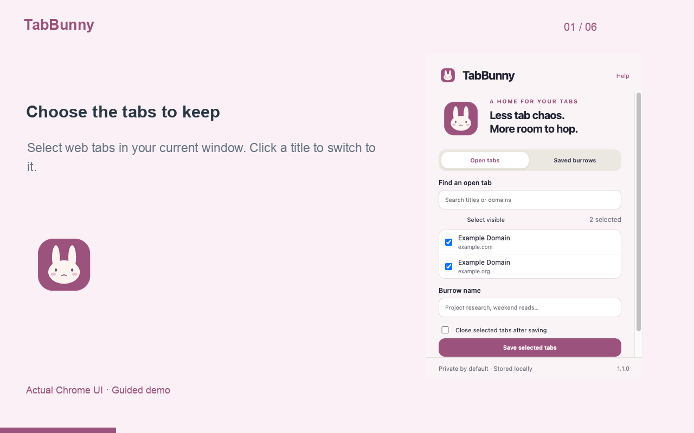

# TabBunny

Your tabs deserve a cozy little home.

TabBunny turns a crowded browser window into saved bunny burrows you can return to later. Choose the tabs you want, name the burrow, and keep your next task ready.

## Features

- Search and jump to web tabs in the current window.
- Save selected tabs into named burrows, with duplicate links removed.
- Optionally close selected tabs after they have been saved successfully.
- Browse saved links, rename burrows, and restore them in a new window.
- Restore pinned state and export or import JSON backups.

## Limits

Stores up to 100 burrows with 300 web tabs each. HTTP and HTTPS pages only; internal browser pages, local files, and URLs with embedded credentials are skipped. TabBunny keeps current tabs open unless you explicitly choose to close them. Saved links do not preserve form edits, cookies, page scroll positions, or login state. Closing tabs can lose unsaved page input.

## Development

Open `chrome://extensions`, enable Developer mode, choose **Load unpacked**, and select `extension/`. All runtime assets are packaged locally.

Run `npm test` for logic tests. Run `npm run package` to validate and create an upload ZIP in `dist/`. No build step or runtime package dependencies are required.

## Privacy

Local collections contain names, page URLs and titles, pinned flags, and creation timestamps.

`tabs` reads the current window's URLs, titles, and pinned state when you use the app. `storage` saves your burrows on this device. No website content is read.

See [PRIVACY.md](PRIVACY.md). No developer servers, advertising, or analytics.

## Support

Report reproducible bugs through this repository's issue tracker. Remove private information first.

## License

MIT.

## See it in action

[Watch the MP4](store/demo/walkthrough.mp4) · [Read the step-by-step guide](store/demo/README.md)
